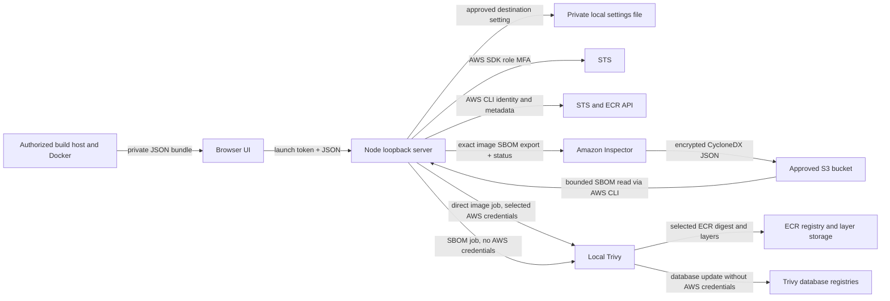

# Architecture and local API

ECR Sentinel is a local, single-user Node.js application with a browser UI. The Node server binds to `127.0.0.1` and serves static files plus an internal JSON API. AWS CLI handles inventory, Inspector SBOM exports, S3 retrieval, and direct image credentials. The AWS SDK credential provider handles supported in-app role MFA. Trivy performs vulnerability checks on the Mac. An optional build-host helper produces an SBOM from a locally available final Docker image.

## Component map



| File | Responsibility |
| --- | --- |
| `server.js` | Loopback HTTP server, launch token, Host/Origin checks, static-file restrictions, security headers. |
| `src/api.js` | Internal route dispatch, JSON limits, uniform error responses. |
| `src/aws-cli.js` | Profile discovery, authentication method detection, SDK role MFA, AWS CLI calls, Inspector destination validation, export/status, bounded S3 retrieval, credential export. |
| `src/inspector-settings.js` | Private, account/Region/profile-scoped Inspector export destination persistence and safe local file writes. |
| `src/trivy.js` | Scanner preflight, queue, database preparation, direct and SBOM scan execution, Inspector export orchestration and SBOM identity checks, report normalization and retention. |
| `public/index.html`, `public/styles.css`, `public/app.js` | Accessible browser UI, connection flow, inventory, scan actions, findings, CSV export. |
| `public/auth-guide.js` | Profile-specific sign-in instructions. |
| `scripts/generate-sbom-bundle.mjs` | Build-host helper that binds a local Docker image to an ECR digest/platform and writes a private bundle. |

The app has no hosted backend, application user database, account signup, or multi-tenant model. It stores only Inspector destination configuration locally; reports remain in memory, and Inspector's SBOM object is stored in the administrator-approved AWS bucket. It is intended to run as a standard macOS user with an already configured AWS identity.

## Product and runtime model

The target user is an engineer or security analyst working from an authorized Mac and VPN connection. Their workflow begins with a locally configured AWS profile, narrows inventory to one ECR repository and immutable image digest, chooses a scan route that their permissions support, and ends with a local findings report. The primary views are profile connection, repository/image inventory, image details, Inspector destination setup, scan progress, and findings. The key records are a selected image target, optional saved Inspector destination, transient scan job, normalized report, and optional imported SBOM bundle.

This release is complete when a user can connect with a supported AWS profile, inspect image metadata, run an authorized scan route, see a clear outcome or recovery error, and export the findings. It does not provision AWS infrastructure. The Mac needs Node.js, AWS CLI v2, and a supported Trivy executable; Docker is only needed on a separate authorized build host when using the bundle helper. The runtime assumes the operating-system account and its AWS configuration are trusted. A person who can edit the local AWS profile, launch the process, or read its launch URL already has substantial control over this application.

### Data objects and ownership

| Object | Important fields | Authority and lifetime |
| --- | --- | --- |
| Image target | `profile`, `region`, `repository`, `digest`, `platform` | The browser chooses it; the server validates syntax, resolves the current STS account, and rechecks repository/image metadata when work starts. A tag is display metadata; the digest is the scan key. |
| AWS identity | 12-digit `account` and caller ARN | Returned by STS for the chosen profile and Region. The browser cannot assert the account for a scan or destination setting. |
| Inspector destination | `bucketName`, `keyPrefix`, `kmsKeyArn` | Entered by the operator once per verified profile/account/Region; stored privately on disk. AWS IAM, bucket policy, and key policy decide whether it can actually be used. |
| Scan job | Random UUID, target, account, mode, status, phase, timestamps, optional error | In memory for the lifetime of the server, with bounded recent history. This is a progress and cancellation record, not a durable work queue. |
| Report | Scan identity, provenance, DB timestamp, counts, findings, coverage note | Normalized from a successful Trivy JSON result; retained in memory and keyed to the exact target plus scan route. |
| Imported bundle | `schemaVersion`, exact target claims, producer/generation metadata, SBOM JSON | Supplied by a build host or another trusted process. The server validates structure and equality to the selected target, but it cannot prove who produced the bytes. |
| Inspector export object | CycloneDX JSON at a unique S3 prefix | Created by Inspector in the administrator-approved bucket. The local app reads and validates it, then leaves the object in S3 for the bucket's lifecycle policy. |

The browser remembers its selected profile and Region and launch token in **tab session storage**. It does not persist reports, imported SBOMs, MFA codes, or AWS credentials. A browser refresh can recover a retained job/report while the same Node process is running. Restarting Node creates a new launch token and clears in-memory jobs, reports, and MFA sessions.

### Three scan routes

| Route | Input material | AWS actions | What Trivy receives | Main prerequisite |
| --- | --- | --- | --- | --- |
| Direct image | Remote ECR image at an exact digest | STS/ECR metadata and ECR registry pull through the selected profile | Image layers and manifest, plus exported AWS credentials in the child environment | The caller can read/pull the image. |
| Imported SBOM | JSON bundle made from the final image on a host that can inspect it | STS/ECR metadata only on this Mac | Private local SBOM file; **no AWS credentials** | A trusted producer can make and securely transfer a bundle. |
| Inspector SBOM | Inspector export for the selected digest | STS/ECR metadata, Inspector create/get export, S3 list/get | Private local SBOM file; **no AWS credentials** | Inspector monitors the image; an approved S3/KMS destination exists; the caller has export/status/read permissions. |

These routes answer different permission constraints. A caller who cannot pull image layers may still scan package entries in an Inspector SBOM if the AWS team permits the export and object read. A caller with only read-only API actions cannot initiate an Inspector export. A report derived from an SBOM covers the packages **present in that SBOM**; it cannot identify packages omitted by the producer.

## Trust boundaries

1. **Browser to local server.** The server generates a 256-bit random token per run and prints it in the launch URL fragment. The browser moves it into tab session storage and sends it in `X-ECR-Sentinel-Token` on API requests. Static assets do not contain the token. API requests also pass Host and Origin checks; CORS is not enabled. Anyone holding the launch URL while the server runs can use the app as that local OS user.
2. **Local server to AWS.** Named profiles are taken from AWS CLI configuration. For a supported MFA role, the one-time code is handed to the AWS SDK provider and temporary credentials remain in server memory. Other profiles use AWS CLI's established credential chain/cache. Calls use fixed command arguments through `execFile`; the shell is not used.
3. **Browser to local destination settings.** A launch-token holder can create, read, change, or remove the bucket, prefix, and KMS ARN setting for a verified profile, account, and Region. The server stores those nonsecret values in a private owner-only file and supplies them to future Inspector scan requests. The setting is an operator convenience, **not** an administrator-enforced destination allowlist. AWS IAM, S3, and KMS policies must enforce the organization's approved destination.
4. **Local server to Inspector and S3.** The request uses an exact ECR image resource ID, account, and resource type filter, then stores Inspector's export in the configured S3 bucket under a random per-job prefix. The server checks export status/destination and reads one bounded object from that prefix. S3/KMS permissions are controlled by the AWS team. The export remains in S3 after the local job ends; the app does not delete it. A strictly read-only role cannot call `CreateSbomExport` because AWS categorizes it as Write.
5. **Local server to Trivy.** Trivy is a child process. Its database update runs without AWS credentials. A direct image scan passes the selected profile's credentials in its child environment and instructs Trivy to fetch the selected ECR image by digest; IAM policy, rather than the app's command line, limits what those credentials can access. Both SBOM scan paths pass no AWS credentials and read a temporary private file.
6. **Build host to Mac.** An imported SBOM is untrusted input even if its metadata matches the selected ECR digest. The importer validates shape, size, account, Region, repository, digest, platform, and optional Trivy RepoDigest property; it does not verify a signature or attest package completeness.
7. **Inspector SBOM to Mac.** The Inspector export is checked for CycloneDX 1.4 format, one account, ECR resource type, image digest, and architecture. Inspector's published SBOM metadata may lack repository, Region, OS, and variant; those limits remain explicit. The checked metadata is not an attestation of package completeness.
8. **Third-party content.** ECR metadata, image layers, SBOM JSON, Trivy output, and advisory URLs may be attacker controlled. The UI inserts text as text, accepts only HTTPS advisory links, and protects exported CSV cells against formula interpretation.

See the [security audit](../SECURITY_AUDIT.md) for residual risks and tests.

## Connection, inventory, and authentication

The UI asks the server for configured AWS profile names; it does not enumerate credentials or accept an arbitrary user-supplied registry endpoint. The profile detector reads AWS CLI configuration to select one of five sign-in guides: standard credentials, IAM user MFA, role profile with `mfa_serial`, IAM Identity Center, or IAM Identity Center with the newer `aws login` flow. For a supported role profile, the UI accepts an OTP and sends it once to `POST /api/auth/mfa`. The SDK's shared configuration provider assumes that role and caches temporary credentials only in the Node process. The endpoint returns account, role ARN, Region, and expiry, never secret keys or the OTP. It allows at most five attempts per minute per profile and one in-flight MFA attempt across the process.

The in-app OTP path intentionally supports a narrow, auditable configuration: one role with `role_arn`, `mfa_serial`, and one `source_profile`. Role chaining, `credential_process`, or extra source MFA steps require the user's normal AWS sign-in workflow. For other profile types, AWS CLI handles its configured credential chain or existing cache. Expired sessions surface a recoverable connection error; retrying an Inspector or image operation may require sign-in again. The app does not persist the OTP or the assumed-role access keys.

After successful STS identity resolution, ECR `DescribeRepositories` and `DescribeImages` supply paginated inventory (up to 100 entries per page). The server validates returned account and repository information before a direct scan. The UI's search and sort operate on pages already loaded into that browser session. For a large registry, users must load more pages to include them in the local search. The image drawer records the selected digest and platform; all scan requests bind to that exact target.

### Direct image execution

1. The server validates profile, Region, repository, 64-hex SHA-256 digest, and platform; resolves the current STS account; and enqueues the request.
2. At execution, it rechecks account identity, repository URI, and that `DescribeImages` still reports the digest in an active state. This limits stale browser selection and profile/account switches.
3. It checks Trivy's version and updates the vulnerability DB in a child environment without AWS credentials. The Java DB is downloaded when needed.
4. It exports credentials from the selected AWS profile or uses the in-memory MFA role session, then checks those credentials against STS. Credentials may be short-lived role tokens or long-lived IAM-user keys, depending on the profile. Trivy receives only the selected digest reference, platform, and bounded options through an argument array; its child environment contains those credentials so it can fetch registry content. IAM policy determines their actual scope.
5. The parser accepts a Trivy result only if the artifact name/type match the selected image and the image configuration reports the requested OS/architecture/variant. The report then enters the in-memory result store.

The direct route is unavailable when the AWS identity lacks ECR registry pull/layer access. It never asks ECR to perform the vulnerability scan; Trivy analyzes the remotely pulled content on the Mac. Image layers can reach local temporary storage through Trivy's cache even when the app does not explicitly save an image tarball.

### Imported SBOM execution

1. An authorized build host runs the bundle helper against an existing final Docker image. The helper requires the local image's `RepoDigests` to include the selected ECR digest, checks the requested platform, and scans the local image ID with Trivy to generate CycloneDX JSON. It checks that the local image ID is unchanged afterward and writes a mode-`0600` bundle.
2. The user securely transfers that JSON bundle to the Mac and imports it in the image drawer. The browser sends the bundle in one bounded JSON request. The app checks the claimed account/Region/repository/digest/platform against the current selection and verifies SBOM format and structural limits.
3. The server rechecks STS identity and image metadata, updates the vulnerability DB, writes the SBOM to a private temporary file, runs `trivy sbom` without AWS credentials, normalizes the result, and deletes the temporary file in its normal cleanup path.

This route does not need image pull permission on the Mac, but its association with the remote ECR digest remains a **producer assertion**. The current bundle has no signature, attestation chain, or transparency record. A valid-looking bundle from the wrong image could produce misleading findings.

### Inspector SBOM execution

1. The operator saves a bucket, key prefix, and KMS key ARN through the setup UI. The server validates shape, resolves STS identity, and stores the destination under that profile/account/Region. Each scan request contains only target fields; per-request destination overrides are rejected.
2. At execution, the server rechecks identity and ECR image metadata, and calls Inspector `CreateSbomExport` with an exact account ID, ECR resource type, and resource ID filter for the image digest. It requests CycloneDX 1.4 JSON and adds a random job subprefix under the saved prefix.
3. The server polls `GetSbomExport` until success, failure, cancellation, or the export deadline. On success it checks the returned format, filters, and destination against the request.
4. S3 listing must find exactly one object under that unique prefix. The server bounds the object to 16 MiB and reads it with a matching ETag condition into a private file. It checks file type, ownership, mode, and byte count before parsing.
5. The app checks Inspector's SBOM metadata for account, ECR resource type, selected digest, and architecture. It then runs the same credential-free local `trivy sbom` path as an imported bundle.

The Inspector SBOM may omit repository, Region, OS, or platform variant in its embedded metadata. Consequently the UI accepts only Linux platforms without a variant for this route, and describes its image association as metadata-verified. The exact export filters and account binding add confidence, but they do not cryptographically attest package completeness. Inspector's S3 object remains in the bucket after scan completion or cancellation.

## Internal API

The API is for the included browser UI and is not versioned as an external integration contract. It requires the launch-token header on **every** `/api/` request. POST requests with bodies send `Content-Type: application/json`. Success responses use JSON; errors use:

```json
{
  "error": {
    "code": "EXAMPLE_CODE",
    "message": "A recoverable, user-facing explanation."
  }
}
```

| Method | Route | Input | Result |
| --- | --- | --- | --- |
| GET | `/api/profiles` | Optional `refresh=1` | `profiles`: configured AWS profile names. |
| GET | `/api/auth-method` | `profile` | `authMethod`: `role-mfa`, `sso`, `login`, `iam-user-mfa`, or `standard`. |
| POST | `/api/auth/mfa` | JSON `profile`, `region`, `code` | Account, role ARN, Region, and session expiry; never credentials or the code. |
| GET | `/api/identity` | `profile`, `region` | Current account and caller ARN. |
| GET | `/api/repositories` | `profile`, `region`, optional `nextToken` | Up to 100 repository summaries and next token. |
| GET | `/api/images` | `profile`, `region`, `repository`, optional `nextToken` | Up to 100 image summaries and next token. |
| GET | `/api/scanner/status` | None | Trivy availability, version, or a scanner error. |
| GET | `/api/inspector/destination` | `profile`, `region` query parameters | Saved destination for the resolved profile/account/Region, or `configured: false`. |
| PUT | `/api/inspector/destination` | JSON `profile`, `region`, `destination: { bucketName, keyPrefix, kmsKeyArn }` | Save a validated destination scoped to the resolved profile/account/Region. |
| DELETE | `/api/inspector/destination` | `profile`, `region` query parameters | Remove that saved destination. |
| GET | `/api/scans/latest` | `profile`, `region`, `repository`, `digest`, `platform` | Latest matching report and job, if still retained. |
| POST | `/api/scans` | JSON target fields above | HTTP 202 and queued or active direct-image job. |
| POST | `/api/scans/sbom` | JSON target fields and `bundle` | HTTP 202 and queued or active SBOM job. |
| POST | `/api/scans/inspector` | JSON target fields only | HTTP 202 and queued or active Inspector export → local Trivy SBOM job, using the saved destination. Returns HTTP 409 `INSPECTOR_DESTINATION_NOT_CONFIGURED` if none is saved. |
| GET | `/api/scans/:id` | UUID job ID | Current status, phase, timestamps, error, and completed report if retained. |
| DELETE | `/api/scans/:id` | UUID job ID | Cancellation request or final job state. |

A scan target is `profile`, `region`, `repository`, `digest`, and `platform`. The digest must be a `sha256:` value with 64 lowercase hex digits; the default platform is `linux/amd64`. The app verifies the profile exists locally, resolves the AWS account, and rechecks the selected image and account during job execution. The SBOM upload body is limited to 20 MiB; ordinary JSON bodies are limited to 16 KiB.

Example target payload, using placeholders rather than real account data:

```json
{
  "profile": "sentinel-review",
  "region": "us-east-1",
  "repository": "team/service",
  "digest": "sha256:aaaaaaaaaaaaaaaaaaaaaaaaaaaaaaaaaaaaaaaaaaaaaaaaaaaaaaaaaaaaaaaa",
  "platform": "linux/amd64"
}
```

The browser handles token storage and requests. External scripts should not extract a live launch token from another session or treat this unversioned API as a remote service. The settings API resolves STS identity before reading or modifying the profile/account/Region entry; destination fields in a scan request are rejected.

### Request and response details

Query strings must use normal URL encoding, especially when a repository contains a slash or an AWS continuation token contains punctuation. The browser sends JSON for POST and PUT; a wrong content type returns HTTP 415. Authentication uses the private `X-ECR-Sentinel-Token` header, independent of AWS identity. An HTTP 403 for `INVALID_API_TOKEN` usually means the browser used an old launch URL after a server restart. HTTP 403 `LOCAL_ONLY` means Host or Origin was not a permitted loopback origin.

The destination request has this shape (all values are illustrative):

```json
{
  "profile": "sentinel-review",
  "region": "us-east-1",
  "destination": {
    "bucketName": "approved-security-exports",
    "keyPrefix": "teams/service/sboms",
    "kmsKeyArn": "arn:aws:kms:us-east-1:111111111111:key/00000000-0000-0000-0000-000000000000"
  }
}
```

`GET /api/inspector/destination` returns `{"configured":false,"destination":null}` when no setting exists. On a successful PUT it returns `configured: true` with the normalized destination. This is configuration only: the API does not create the bucket or key, grant policies, or test that the next export will succeed. The server strips a trailing slash from `keyPrefix`; each scan appends a unique `ecr-sentinel/<UUID>/` subprefix.

The three scan start routes return HTTP 202 with a job record. Example:

```json
{
  "id": "00000000-0000-4000-8000-000000000000",
  "mode": "inspector-sbom",
  "status": "PENDING",
  "phase": "queued",
  "createdAt": "2026-10-21T14:00:00.000Z",
  "startedAt": null,
  "completedAt": null
}
```

The job can already be `IN_PROGRESS` by the time the response arrives. Poll `GET /api/scans/:id`; a completed job includes a `report` object while it is retained. A failed job includes a sanitized `error: {code,message}`; it never returns raw AWS CLI stderr or raw Trivy output. `DELETE /api/scans/:id` marks a queued job canceled immediately. For a running job it asks the local work to abort, so poll again for the final state. A completed or failed job cannot be turned back into pending.

The normalized report includes `scanMode` (`image` or `sbom`), selected target and verified account, scan and database timestamps, scanner version, severity `counts`, an array of findings, and a `coverage` section. SBOM reports have top-level `source: "Trivy SBOM"` and a nested `provenance` object with the SBOM SHA-256, generation time, producer, format, and association strength. An Inspector-origin report has `provenance.source: "amazon-inspector"` and `provenance.association: "metadata-verified"`. An imported bundle uses `provenance.association: "unverified"`. A finding contains vulnerability ID, severity, affected package and version, optional fixed version, score, sanitized HTTPS advisory URL, and result target/type. The UI derives table filtering and CSV from this normalized shape; it does not display arbitrary Trivy JSON.

`GET /api/scans/latest` returns `{report,job}` for the selected target, with null members when none are retained. It can return the most recent job and the most recent successful report from different scan routes; compare their IDs and scan modes rather than assuming one produced the other. A report may disappear before its job record when the ten-report cap is reached.

### Validation and error semantics

| Condition | Typical HTTP status/code | Operator meaning |
| --- | --- | --- |
| Missing or stale launch token | 403 `INVALID_API_TOKEN` | Open the current private launch URL. |
| Unsupported method or route | 405 `METHOD_NOT_ALLOWED` or 404 `NOT_FOUND` | The local API route/method does not exist. |
| Invalid profile, Region, repository, digest, platform, or JSON | 400/422 with a specific code | Correct the selected target or imported bundle. |
| No saved Inspector destination | 409 `INSPECTOR_DESTINATION_NOT_CONFIGURED` | Set up the approved destination for the current account and Region. |
| Queue or SBOM upload busy | 429 `SCAN_QUEUE_FULL` or `SBOM_UPLOAD_BUSY` | Wait for current local work and retry. |
| Oversize request, SBOM, or report | 413 with a size-specific code | Use a smaller input or change limits deliberately in source. |
| AWS permission or service failure | Mapped `AWS_*` or `INSPECTOR_*` error | Check the exact profile, IAM/S3/KMS permissions, and service state; raw CLI diagnostics stay server-side. |
| Scanner unavailable, unsafe version, timeout, or invalid result | `TRIVY_*`/`SBOM_*` error | Correct local Trivy installation, database access, SBOM format, or timeout condition. |

Ordinary JSON bodies are capped at 16 KiB and bundle uploads at 20 MiB. The SBOM JSON within a bundle must be at most 16 MiB. The HTTP server also has a 20-second request timeout, which can matter for a slow 20 MiB upload across a stressed local machine. The API admits only one bundle upload at a time so a second upload receives a clear 429 response instead of increasing memory pressure.

## Job lifecycle and limits

Jobs move through `PENDING`, `IN_PROGRESS`, then `COMPLETE`, `FAILED`, or `CANCELED`. Phases include preflight, database update, scan, and report processing. Inspector jobs also request, wait for, and retrieve the export. One job runs at a time and up to three may wait. Duplicate active requests for the same target, mode, and destination reuse the existing job. Each Trivy scan process has a 15-minute limit; Inspector export wait is capped at 12 minutes and the overall job deadline is 30 minutes. Direct image analysis is capped at 4 GB, imported and Inspector SBOMs at 16 MiB, report output at 64 MiB, and normalized findings at 5,000. Canceling a job stops local work; AWS may still finish an export already requested.

The first scan on each server run updates Trivy's vulnerability database; another update is attempted after six hours. Java database download may occur when a scan needs it. Reports are normalized into a common schema with scan mode, account, digest, platform, database timestamp, coverage, severity counts, findings, and SBOM provenance. Manual bundles carry producer claims; Inspector reports identify metadata-verified Inspector exports.

The server keeps at most 40 recent job records and ten completed reports **in memory**. Reports disappear on server restart. The nonsecret Inspector destination settings survive restart in `~/Library/Application Support/ECR Sentinel/inspector-destinations.json` by default, in a mode-`0700` directory and mode-`0600` file. `ECR_SENTINEL_DATA_DIR` can specify an absolute alternative directory; protect that path with the same owner-only permissions. Locking a browser tab does not erase settings; the settings API can remove an entry. Imported SBOM bytes are held while queued, written to a mode-`0600` temporary file for Trivy, and removed after normal completion or cancellation. Trivy database and analysis cache persist in `ecr-sentinel-trivy-cache` under the user's operating-system temporary directory. Hard kills may leave a temporary SBOM file; startup cache initialization removes matching files older than one hour. Exported CSV is written only when the operator requests it.

### State machine and scheduling

`PENDING` jobs begin in `queued`. The single worker moves one to `IN_PROGRESS` and `preflight`; route-specific phases then follow. Direct scans use `updating-db`, `scanning`, and `processing`. Imported bundles use `updating-db`, `scanning-sbom`, and `processing`. Inspector scans add `requesting-sbom`, `waiting-for-sbom`, and `retrieving-sbom` before the local SBOM phases. Terminal states are `COMPLETE`, `FAILED`, and `CANCELED`, with corresponding terminal phase names. Job timestamps are ISO 8601 UTC strings.

The queue is process-local and serial. A duplicate active request returns the existing job when target, account, mode, and relevant bundle/destination hash match. Otherwise there may be one active job plus three waiting jobs. The UI polls job status; no WebSocket or cross-process worker is present. On graceful server close the scan service aborts outstanding local jobs. An Inspector export already accepted by AWS can continue after local cancellation or process exit, and its object may later appear in S3.

| Boundary | Current limit | Why it exists |
| --- | --- | --- |
| Job history / reports | 40 job records / 10 reports | Bounds resident memory; oldest completed records are evicted. |
| Queue | One worker, three pending jobs | Bounds AWS calls and concurrent local Trivy work. |
| Scan and export time | 15 minutes per Trivy scan; 12 minutes Inspector poll; 30 minutes overall job | Prevents indefinite local work. AWS can continue an accepted export. |
| Scanner output | 64 MiB stdout and 64 KiB stderr | Bounds child-process capture; overrun kills the process. |
| Direct image | Trivy option limits image to 4 GB | Avoids very large pulls/analysis; Trivy and OS caches may still consume local disk. |
| SBOM upload / SBOM document | 20 MiB HTTP JSON body / 16 MiB serialized SBOM | Leaves room for bundle metadata while bounding parse and temporary storage. |
| SBOM structure | 100,000 packages, 250,000 JSON nodes, depth 64 | Limits parser complexity and memory amplification. |
| Normalized findings | 5,000 findings or 5 million finding characters | Prevents an unusably large browser report. |
| Settings file | 128 KiB | Bounds operator configuration data on disk. |
| Scanner status cache | 30 seconds | Avoids spawning Trivy for each UI status refresh. |
| Vulnerability DB refresh | At first scan of a server run, then after six hours | Keeps data reasonably current while avoiding a download before every job. |

The Trivy process has its own limited environment. It keeps only selected proxy, CA, path, locale, and home variables needed for enterprise VPNs; it strips inherited Trivy/Docker/AWS settings that could redirect scan behavior, disables EC2 metadata lookup, points AWS config files at `/dev/null`, and uses an empty Docker config. Only the direct image scan receives the selected profile's AWS credentials; static IAM-user profiles can therefore pass long-lived keys to that child process. All child commands use argument arrays with shell execution disabled.

### Persistence, privacy, and failure recovery

The destination store is versioned JSON keyed by a SHA-256 of profile/account/Region. On each read it verifies the directory/file are owned by the current OS user, are private, and are not symlinks; writes use an exclusive mode-`0600` temporary file, fsync, and rename. A corrupt or unsafe settings file is an error rather than silently reset, so an operator can investigate and repair it. Multiple writes in one process are serialized; the store is not designed for two independent ECR Sentinel server processes mutating the same file concurrently.

The in-memory report is sensitive because it can reveal repository names, package names, versions, and vulnerability posture. The Inspector S3 object and imported bundle can reveal more of the package inventory. Application settings contain bucket/account information even though they contain no keys. Protect the Mac user account, terminal output that contains the launch URL, downloaded CSV, build-host bundle, and S3 destination. Clearing browser tab state does not revoke a token already held by another tab; stopping Node invalidates the per-run token and temporary role sessions.

Failure responses are intentionally user-facing summaries. Diagnostic stderr from AWS CLI and Trivy is used for local classification but is not reflected verbatim into the browser. The UI can retry a connection or scan after credentials, permissions, database access, destination policy, or Inspector coverage are fixed. A failed report is not published as a partial successful scan. When a scan has no detected OS or language package targets, the report marks limited coverage and warns that zero findings do not establish a clean image.

## Architectural limits

The browser searches and sorts loaded inventory pages, not every item in a large account. The app supports one account and Region in the current workspace and one selected platform per scan. No background scheduler, organization-wide scan fleet, signed SBOM validation, permanent report store, triage state, role-based access control, or production deployment gate is implemented. This local architecture should not be exposed as a public network service without a separate security design.
